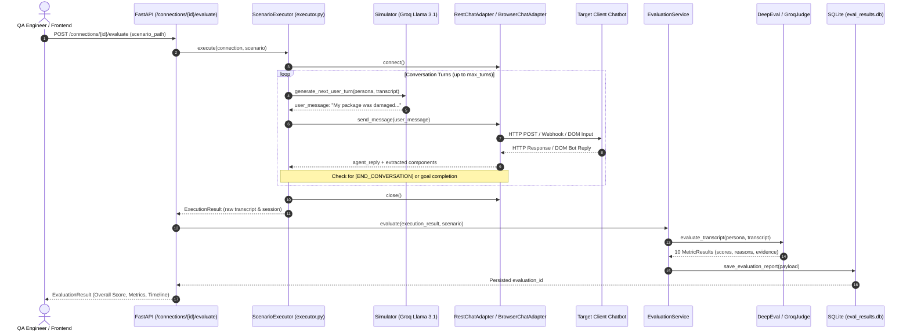
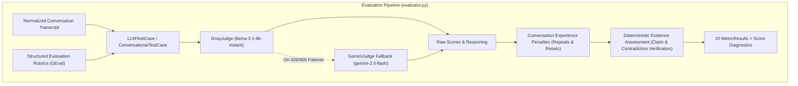
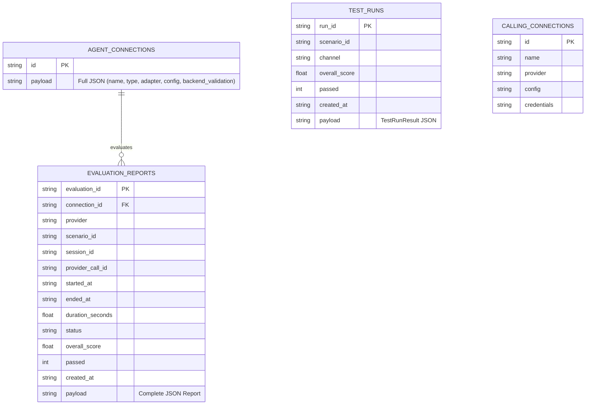

# EvalForge — Universal AI Agent Evaluation Platform
## Complete Project Architecture, Code Walkthrough, and Engineering Codex

---

## 1. Executive Summary

**EvalForge** is a vendor-neutral, automated evaluation platform built in Python (FastAPI backend) and modern vanilla JavaScript (single-page dashboard) for testing, scoring, and stress-testing AI chatbots, voice agents, and AI calling agents.

Rather than running static assertions against pre-scripted responses (traditional unit testing), EvalForge simulates real human users using dynamic LLMs (Groq `llama-3.1-8b-instant` or local Ollama `llama3.1:8b`). These simulated users engage client agents in multi-turn, goal-driven conversations across HTTP/REST, WebSocket, Playwright headless/headed browser sessions, WebRTC audio (LiveKit), or telephone call providers (Vapi, Twilio).

Once an interaction completes, EvalForge runs the normalized conversation transcript and evidence through an **Evaluation Engine** powered by **DeepEval** and a **Groq LLM-as-a-Judge** (with automatic fallback to Google Gemini `gemini-2.0-flash`). The engine calculates ten standardized conversational quality metrics, extracts turn-level evidence, applies deterministic heuristics to detect hallucinated data, loops, or resets, optionally checks RAG retrieval fidelity, executes independent backend SQL/REST validation, and compiles enterprise-grade audit reports in JSON, HTML, PDF (ReportLab), and DOCX (python-docx).

### Key Architectural Strengths
1. **Decoupled Three-Tier Topology:** Clean separation between **Connection** (how to reach the target agent), **Scenario** (what the user tests and expects), and **Evaluation** (how the conversation is judged and audited).
2. **Deterministic Evidence Validation:** Eliminates judge hallucination by combining LLM semantic rubrics with deterministic factual claim extractors, numerical consistency validators, and contradiction detectors.
3. **Multi-Protocol Telephony & Voice Architecture:** Supports local audio pipelines (Faster-Whisper STT + Piper TTS), real-time WebRTC audio (LiveKit), and telephony calling pipelines (Vapi and Twilio).
4. **Interactive Form & Human-in-the-Loop Protocol:** Includes an asynchronous pause/resume protocol over WebSockets that permits manual human intervention or automated UI action simulation (OTPs, webcam capture, file drops, button selections).

---

## 2. Project Purpose and Scope

### What Problem Does EvalForge Solve?
1. **The Non-Deterministic Testing Bottleneck:** AI agent outputs change based on temperature, prompt revisions, model updates, and knowledge retrieval. String-matching unit tests fail on semantically correct answers and pass on polite hallucinations.
2. **Siloed Testing Tools:** Engineering teams use disparate tools for chatbot APIs, browser testing, telephony, and RAG pipelines. EvalForge standardizes all three agent modalities under a single evaluation schema.
3. **Unverified Agent Claims:** Chatbots frequently claim *"I have canceled your order"* or *"Your appointment is confirmed"* when no backend transaction took place. EvalForge's Backend Validation Engine connects directly to client databases and REST APIs to verify that claimed actions actually occurred.

### Target Personas
- **QA Automation Engineers:** Build automated regression test suites that run against agent staging and production endpoints.
- **AI & LLM Engineers:** Measure model improvements, prompt updates, and guardrail effectiveness using repeatable benchmarks.
- **Enterprise Product Leaders:** Receive executive summary reports detailing task pass rates, latency metrics, and failure modes.

### Scope & Agent Modalities
- **Chatbots:** REST APIs (single-turn & multi-step polling), WebSocket chat streams, and Playwright-automated browser chat widgets.
- **Voice Agents:** Full-duplex audio streams over LiveKit WebRTC or local microphone/speaker audio with Piper TTS and Faster-Whisper STT.
- **Calling Agents:** Inbound and outbound telephony agents connecting over Twilio or Vapi APIs with call recording and raw dual-channel audio ingestion.

---

## 3. Current Feature Status Audit

All subsystem statuses are classified based on direct code inspection:

| Subsystem / Feature | Status | Evidence (File / Function) | External Requirements | Notes / Current Limitations |
|---|---|---|---|---|
| **REST Chatbot Adapter (Single-turn)** | **IMPLEMENTED** | [RestChatAdapter](file:///d:/bestQ/evalution-ai-agent/app/adapters/chat/rest.py#L394) | Target HTTP Endpoint | Full request/response templating, headers, auth tokens. |
| **REST Chatbot Adapter (Multi-step Polling)** | **IMPLEMENTED** | [RestChatAdapter._send_and_receive_multi_step](file:///d:/bestQ/evalution-ai-agent/app/adapters/chat/rest.py#L750) | Target HTTP Endpoint | Supports session creation, message submission, and response polling. |
| **Browser Chatbot Adapter** | **IMPLEMENTED** | [BrowserChatAdapter](file:///d:/bestQ/evalution-ai-agent/app/adapters/chat/browser.py) | Playwright Chromium | Handles DOM clicks, inputs, text extraction, screenshots. |
| **Browser Authentication Manager** | **IMPLEMENTED** | [BrowserAuthManager](file:///d:/bestQ/evalution-ai-agent/app/connections/browser_auth.py) | Playwright, Target Web UI | Handles interactive logins, saves `storage_state.json`. |
| **DeepEval + Groq LLM Judge** | **IMPLEMENTED** | [GroqJudge](file:///d:/bestQ/evalution-ai-agent/app/evaluator.py#L156) | `GROQ_API_KEY` | Primary judge model: `llama-3.1-8b-instant`. |
| **Gemini Judge Fallback** | **IMPLEMENTED** | [GeminiJudge](file:///d:/bestQ/evalution-ai-agent/app/evaluator.py#L257) | `GEMINI_API_KEY` | Automatic failover when Groq hits 429/500 errors. |
| **10 Conversational Quality Metrics** | **IMPLEMENTED** | [_build_metrics](file:///d:/bestQ/evalution-ai-agent/app/evaluator.py#L361) | DeepEval, Groq/Gemini | Goal completion, tone, intent, context retention, etc. |
| **Deterministic Evidence Assessment** | **IMPLEMENTED** | [assess_factual_claims](file:///d:/bestQ/evalution-ai-agent/app/evaluation_evidence.py#L41) | None | Caps scores upon verified numerical/factual mismatch. |
| **Conversation Experience Penalties** | **IMPLEMENTED** | [_apply_conversation_experience_penalties](file:///d:/bestQ/evalution-ai-agent/app/evaluator.py#L918) | None | Caps scores when agent repeats questions or resets workflow. |
| **RAG Evaluation (Turn & Context)** | **IMPLEMENTED** | [_build_rag_metrics](file:///d:/bestQ/evalution-ai-agent/app/evaluator.py#L561) | DeepEval, Groq | Faithfulness, relevancy, precision, recall, hallucination. |
| **Backend Business Validation (REST/SQL)** | **IMPLEMENTED** | [BackendValidationEngine](file:///d:/bestQ/evalution-ai-agent/app/backend_validation/engine.py#L12) | SQLAlchemy, requests | Independent verification of database/API state. |
| **Failure Analysis Engine** | **IMPLEMENTED** | [FailureAnalysisEngine](file:///d:/bestQ/evalution-ai-agent/app/failure_analysis/engine.py#L12) | None | Categorizes failures into root causes and recommendations. |
| **Vapi Calling Provider** | **IMPLEMENTED** | [VapiProvider](file:///d:/bestQ/evalution-ai-agent/app/calling/providers/vapi.py#L32) | Vapi API Key | Native voice transport, call initiation, transcript fetching. |
| **Twilio Calling Provider** | **PARTIAL** | [TwilioCallProvider](file:///d:/bestQ/evalution-ai-agent/app/calling/providers/twilio.py) | Twilio Account SID/Auth | Boundary available; full audio stream requires webhook setup. |
| **Retell, Bland, SIP Calling** | **MOCK ONLY / CONFIG ONLY** | [ui_api.py](file:///d:/bestQ/evalution-ai-agent/app/calling/ui_api.py#L435) | External API credentials | UI configuration forms exist; run pipeline uses mock runtime. |
| **LiveKit WebRTC Voice Adapter** | **IMPLEMENTED** | [LiveKitVoiceAdapter](file:///d:/bestQ/evalution-ai-agent/app/adapters/voice/livekit.py) | LiveKit Server | Connects over WebRTC, streams audio, tracks latency. |
| **Local Voice Adapter** | **IMPLEMENTED** | [LocalVoiceAdapter](file:///d:/bestQ/evalution-ai-agent/app/adapters/voice/local.py) | SoundDevice, Piper, Whisper | Runs on local CPU/sound hardware. |
| **Interactive Intervention Protocol** | **IMPLEMENTED** | [InteractionManager](file:///d:/bestQ/evalution-ai-agent/app/interaction_protocol.py#L15) | FastAPI WebSockets | Human-in-the-loop pauses run for OTP, camera, forms. |
| **Multi-Format Report Generation** | **IMPLEMENTED** | [EvaluationReportEngine](file:///d:/bestQ/evalution-ai-agent/app/report_engine.py#L39) | ReportLab, python-docx | JSON, HTML, PDF, and DOCX for Enterprise/Exec/Tech. |
| **Judge Accuracy Benchmark Suite** | **TESTED** | [judge_accuracy.py](file:///d:/bestQ/evalution-ai-agent/app/benchmarks/judge_accuracy.py) | Benchmark dataset | Measures MAE, agreement, variance, false fail rates. |
| **WebSocket Chatbot Adapter** | **PARTIAL / STUB** | [WebSocketChatAdapter](file:///d:/bestQ/evalution-ai-agent/app/adapters/chat/websocket.py) | WebSocket server | Basic frame exchange; full streaming protocol is minimal. |

---

## 4. Technology Stack

### Backend Infrastructure
- **Runtime:** Python 3.10+ (Running on Windows PowerShell environment)
- **Web Framework:** FastAPI `0.115.0` with Uvicorn `0.30.6` (ASGI)
- **Data Validation & Schemas:** Pydantic `2.9.2` and Pydantic-Settings `2.5.2`
- **Database & Persistence:** SQLite3 (raw SQL connections via `eval_results.db`), SQLAlchemy `2.0.53` (used in backend SQL validation)
- **Evaluation Framework:** DeepEval `2.0.9`
- **LLM Inference APIs:**
  - `groq`: Official SDK for primary judging and user simulation
  - `google-generativeai` `0.8.3`: Gemini SDK for judge fallback
  - `requests` `2.32.3`: HTTP client for REST adapters and mock chats
- **Document & Report Generation:**
  - `reportlab` `4.2.5`: Enterprise PDF document rendering
  - `python-docx` `1.1.2`: Microsoft Word report compilation
- **Voice & Telephony Stack:**
  - `faster-whisper`: Optimized local Whisper model inference
  - `piper-tts`: Fast local speech synthesis
  - `sounddevice` & `numpy`: Audio hardware I/O and buffer processing
  - `cryptography`: AES encryption for calling diagnostic traces
  - `pyyaml` `6.0.2`: Scenario definition parser

### Frontend Infrastructure
- **Type:** Single-Page Application (SPA)
- **Architecture:** Vanilla HTML5, CSS3, and JavaScript ES6+
- **Styling:** Custom CSS design system with HSL variables, dark mode (`#090e1a` base), card grids, status badges, skeletons, and glassmorphic modal overlays. TailwindCSS is intentionally avoided.
- **Communication:** Fetch API for REST endpoints; WebSocket for real-time evaluation logs (`/evaluations/{id}/logs/stream`) and human-in-the-loop interventions (`/evaluations/{id}/interactions/stream`).

---

## 5. Repository Structure

```
evalution-ai-agent/
├── app/                                # Core Application Root
│   ├── adapters/                       # Agent Protocol Adapters
│   │   ├── auth.py                     # Universal adapter authentication factories
│   │   ├── base.py                     # Base adapter interfaces & exceptions
│   │   ├── factory.py                  # Universal adapter factory
│   │   ├── chat/                       # Chatbot-specific adapters
│   │   │   ├── base.py                 # ChatAdapter abstract base class
│   │   │   ├── browser.py              # Playwright headless/headed browser adapter
│   │   │   ├── fake.py                 # In-memory mock chatbot adapter
│   │   │   ├── rest.py                 # Generic single & multi-step REST adapter
│   │   │   └── websocket.py            # WebSocket adapter (streaming/events)
│   │   └── voice/                      # Audio & voice adapters
│   │       ├── base.py                 # VoiceAdapter abstract base class
│   │       ├── fake.py                 # In-memory synthetic voice adapter
│   │       ├── livekit.py              # LiveKit WebRTC real-time voice adapter
│   │       └── local.py                # Local mic/speaker Piper + Whisper adapter
│   ├── backend_validation/             # Independent Backend Business Action Validation
│   │   ├── assertions/                 # JSONPath & assertion operator engines
│   │   ├── extractors/                 # Regex, transcript, & JSON variable extractors
│   │   ├── validators/                 # REST & SQL database execution validators
│   │   ├── engine.py                   # Validation orchestrator & connection merger
│   │   ├── models.py                   # Check & Summary Pydantic models
│   │   └── registry.py                 # Validator registry
│   ├── benchmarks/                     # Judge accuracy benchmark engine
│   │   ├── human_review.py             # Human review packet generator & evaluator
│   │   └── judge_accuracy.py           # Benchmark runner: MAE, agreement, retry logic
│   ├── calling/                        # AI Calling & Telephony Evaluation Pipeline
│   │   ├── providers/                  # Telephony providers (Vapi, Twilio, Mock, Whisper)
│   │   ├── execution_pipeline.py       # Calling execution pipeline orchestrator
│   │   ├── voice_transport.py          # Dual-channel audio & WebRTC transport handlers
│   │   ├── ui_api.py                   # FastAPI router for `/calling/*` endpoints
│   │   └── ...                         # Normalizers, artifact collectors, session runners
│   ├── connections/                    # Agent Connection Management System
│   │   ├── api.py                      # FastAPI router for `/connections/*` endpoints
│   │   ├── browser_auth.py             # Playwright interactive browser login manager
│   │   ├── manager.py                  # Connection testing & adapter dispatch
│   │   ├── parser.py                   # Connection input validation & parser
│   │   └── storage.py                  # SQLite `agent_connections` repository
│   ├── failure_analysis/               # Structured failure explanation generator
│   │   ├── engine.py                   # Failure generator registry & context builder
│   │   └── registry.py                 # Registry mapping metric failure categories
│   ├── interactive/                    # Action Engine & Interactive Planning
│   │   ├── action_executor.py          # Executes planned actions on adapters
│   │   ├── component_detector.py       # Detects rich UI components in agent replies
│   │   ├── form_engine.py              # Resolves form fields & fills values
│   │   └── orchestrator.py             # Dynamic ConversationOrchestrator turn loop
│   ├── models/                         # Domain Pydantic models
│   │   ├── connection.py               # AgentConnection & ConnectionType definitions
│   │   ├── conversation.py             # NormalizedConversation, Message, RAGEvidence
│   │   ├── failure_analysis.py         # FailureAnalysis & FailureCategory definitions
│   │   └── voice.py                    # VoiceConversation, AudioSegment, Turn models
│   ├── voice/                          # Voice Evaluation Engine
│   │   ├── audio.py                    # Audio processing utilities (WAV, PCM, resampling)
│   │   ├── metrics.py                  # Deterministic metrics (latency, dead air, jitter)
│   │   ├── persona.py                  # VoicePersonaEngine multi-turn speech loop
│   │   └── runner.py                   # Standalone voice scenario execution runner
│   ├── config.py                       # App settings loaded from `.env` via Pydantic
│   ├── evaluation_evidence.py          # Deterministic factual assessment & contradictions
│   ├── evaluation_service.py           # Evaluates ExecutionResult and computes score
│   ├── evaluation_store.py             # SQLite `evaluation_reports` storage repository
│   ├── evaluations_api.py              # FastAPI router for `/evaluations/*` & streaming
│   ├── evaluator.py                    # DeepEval + Groq/Gemini judge & metric rubrics
│   ├── executor.py                     # ScenarioExecutor for chatbot & voice sessions
│   ├── interaction_dispatcher.py       # Dispatches interactive UI/human fallback
│   ├── interaction_protocol.py         # Thread-safe WebSocket pause/resume manager
│   ├── log_stream.py                   # ContextVar logging handler streamed over WS
│   ├── main.py                         # FastAPI main entry point & static file mounts
│   ├── orchestrator.py                 # Legacy CLI test-run orchestrator
│   ├── rag.py                          # RAG evidence extraction helpers
│   ├── report_engine.py                # 3,400+ line Enterprise/Exec/Tech report engine
│   ├── schemas.py                      # Public request/response API contracts
│   ├── simulator.py                    # LLM-based simulated customer response generator
│   └── workflow_metrics.py             # Multi-turn workflow state transition checks
├── artifacts/                          # Generated evaluation run artifacts & logs
├── benchmarks/                         # Benchmark datasets (cases & review packets)
├── docs/                               # Architectural & technical documentation
├── frontend/                           # Single-Page Application
│   ├── static/
│   │   ├── app.js                      # 4,400+ line UI client & state manager
│   │   └── styles.css                  # Custom responsive CSS design system
│   └── index.html                      # Semantic UI markup & templates
├── scenarios/                          # YAML scenario definition files
├── scripts/                            # Diagnostic, benchmark, & CLI execution tools
└── tests/                              # Comprehensive test suite (141 test files)
```

---

## 6. System Architecture

```mermaid
graph TB
    subgraph UI ["Client Layer (Frontend)"]
        Browser["SPA Dashboard (HTML5 / Vanilla JS)"]
        WSClient["WebSocket Client (Logs & Interventions)"]
    end

    subgraph API ["FastAPI Application Gateway (main.py)"]
        ConnRouter["/connections API"]
        CallingRouter["/calling API"]
        EvalRouter["/evaluations API"]
        ScenarioRouter["/scenarios API"]
        WSLogs["WebSocket /logs/stream"]
        WSInteractions["WebSocket /interactions/stream"]
    end

    subgraph Core ["Execution & Orchestration Layer"]
        Executor["ScenarioExecutor (executor.py)"]
        Simulator["Simulated Customer (Groq / Ollama)"]
        InteractiveEngine["Action Engine / Interaction Dispatcher"]
        InteractionManager["InteractionProtocol (Pause/Resume Event)"]
        CallingPipeline["CallingExecutionPipeline"]
    end

    subgraph Adapters ["Universal Adapter Layer"]
        RestAdapter["RestChatAdapter (Single & Multi-step)"]
        BrowserAdapter["BrowserChatAdapter (Playwright)"]
        LiveKitAdapter["LiveKitVoiceAdapter (WebRTC)"]
        LocalVoiceAdapter["LocalVoiceAdapter (Piper + Whisper)"]
        VapiAdapter["VapiProvider (Telephony)"]
        TwilioAdapter["TwilioCallProvider (Telephony)"]
    end

    subgraph Evaluation ["Evaluation & Quality Engine"]
        EvalService["EvaluationService (evaluation_service.py)"]
        DeepEval["DeepEval Evaluation Core (evaluator.py)"]
        GroqJudge["Groq LLM Judge (llama-3.1-8b-instant)"]
        GeminiFallback["Gemini Judge Fallback (gemini-2.0-flash)"]
        EvidenceEngine["Deterministic Evidence Engine (evaluation_evidence.py)"]
        VoiceMetrics["Deterministic Voice Metrics (latency, dead air)"]
        BackendVal["Backend Business Validation (REST & SQL)"]
        FailureAnalysis["Failure Analysis Engine"]
    end

    subgraph Persistence ["Persistence & Reporting Layer"]
        SQLiteDB[("SQLite Storage (eval_results.db)")]
        ReportEngine["ReportEngine (report_engine.py)"]
        Artifacts["Artifacts (PDF, DOCX, HTML, JSON)"]
    end

    %% Flows
    Browser -->|HTTP REST| API
    WSClient -->|WebSocket| WSLogs
    WSClient -->|WebSocket| WSInteractions
    
    ConnRouter --> Executor
    CallingRouter --> CallingPipeline
    
    Executor --> Simulator
    Executor --> InteractiveEngine
    InteractiveEngine <--> InteractionManager
    InteractionManager <--> WSInteractions
    
    Executor --> Adapters
    CallingPipeline --> VapiAdapter
    CallingPipeline --> TwilioAdapter

    Executor -->|Normalized Conversation| EvalService
    CallingPipeline -->|Normalized Conversation| EvalService

    EvalService --> DeepEval
    DeepEval --> GroqJudge
    GroqJudge -.->|On 429/500 Failover| GeminiFallback
    EvalService --> EvidenceEngine
    EvalService --> VoiceMetrics
    EvalService --> BackendVal
    EvalService --> FailureAnalysis

    EvalService -->|EvaluationResult| SQLiteDB
    EvalRouter --> ReportEngine
    ReportEngine --> Artifacts
    ReportEngine --> SQLiteDB
```



---

## 7. Backend Deep Dive: Core Modules

### 1. `app/evaluator.py`
- **Purpose:** Core DeepEval judge integration and conversational rubric definitions.
- **Why It Exists:** AI agent responses cannot be validated with static regex or substring checks; they require an LLM judge evaluating nuanced conversational dimensions according to strict rubrics.
- **Classes:**
  - `GroqJudge(DeepEvalBaseLLM)`: Primary judge wrapper invoking Groq's chat completion endpoint with JSON schema output.
  - `GeminiJudge(DeepEvalBaseLLM)`: Fallback judge wrapper invoking Google Generative AI API when Groq experiences rate limits or network errors.
- **Functions:**
  - `evaluate_transcript(...)`: Builds test cases (`LLMTestCase`, `ConversationalTestCase`, and turn-level test cases), executes DeepEval metric `.measure()` calls, records judge invocations, normalizes hallucination scores (`1.0 - raw_score`), applies conversation penalties and deterministic evidence assessments, and returns structured `list[MetricResult]`.
  - `_build_metrics(...)`: Instantiates the 10 core conversation `GEval` and `ConversationalGEval` metrics with explicit `evaluation_steps`. If `rag_context` is supplied, appends the 6 RAG evaluation metrics.
  - `_apply_evidence_assessments(...)`: Compares agent claims against independent factual evidence from `app.evaluation_evidence`. Caps hallucination at 0.55 on confirmed fabrication, caps response quality at 0.65 on contradicted facts, and caps multi-turn consistency at 0.55 on confirmed contradictions.
  - `_apply_conversation_experience_penalties(...)`: Detects repeated questions and workflow restarts. Caps context retention and multi-turn consistency at 0.55, and conversational quality at 0.65.
- **Callers:** `EvaluationService.evaluate()` in `app/evaluation_service.py`.

### 2. `app/evaluation_service.py`
- **Purpose:** Orchestrates post-execution evaluation and scoring aggregation.
- **Why It Exists:** Decouples raw conversation execution (`ExecutionResult`) from the scoring logic, voice metric calculations, workflow metrics, backend validations, and report persistence.
- **Classes:**
  - `EvaluationService`: Coordinates evaluation execution.
  - `EvaluationResult(BaseModel)`: Comprehensive result payload containing `evaluation_id`, `overall_score`, `passed`, `conversation`, `metrics`, `voice_metrics`, `rag_evaluation`, `backend_validation`, and `failure_analysis`.
- **Functions:**
  - `evaluate(execution_result, scenario)`: Validates conversation presence, executes `evaluate_transcript()`, gathers voice metrics (if voice agent), gathers workflow metrics, executes independent backend database/API validations via `BackendValidationEngine`, computes a balanced overall score, triggers `FailureAnalysisEngine`, and returns the final `EvaluationResult`.
  - `_balanced_overall_score(metrics)`: Computes the mathematical mean of the base conversational metrics and the RAG metrics separately, then averages the two categories. This prevents a high number of RAG turns from artificially skewing conversation quality scores.

### 3. `app/executor.py`
- **Purpose:** Executes test scenarios against connected agents across modalities.
- **Why It Exists:** Provides a single unified execution entry point for chatbots (REST, Browser) and voice agents (LiveKit, Local), generating a normalized transcript without performing evaluation.
- **Classes:**
  - `ScenarioExecutor`: Instantiates the appropriate adapter via `ConnectionManager`, initializes an `EvaluationSession`, and runs the conversational loop.
  - `ExecutionResult(BaseModel)`: Carries the execution status, raw transcript, timing, session IDs, and failure reasons.
- **Key Execution Flows:**
  - If `settings.enable_user_action_engine` is `True`: Delegates each turn to `ConversationOrchestrator.run_turn()`.
  - If `scenario.steps` is defined: Executes explicit procedural actions (`send`, `click_button`, `select`, `radio`, `checkbox`, `multi_select`, `upload`, `otp`, `date`, `time`, `search`, `form`) via `_execute_chatbot_steps()`.
  - Otherwise (Standard dynamic simulation): Queries `Simulator.generate_next_user_turn()`, checks for interaction dispatching (`dispatch_interaction`), chooses interactive options, checks for loop conditions, and sends the user message to the adapter until `[END_CONVERSATION]` or `max_turns` is reached.

### 4. `app/interaction_protocol.py`
- **Purpose:** Thread-safe pause/resume protocol for human-in-the-loop and dynamic UI interventions.
- **Why It Exists:** Enables an evaluation run to pause execution and solicit user intervention (such as an SMS OTP code, webcam snapshot, document upload, or interactive button selection) over WebSockets.
- **Classes:**
  - `InteractionManager`: Thread-safe manager using `threading.Event` to halt execution worker threads while dispatching WebSocket events to connected frontend clients.
- **Key Methods:**
  - `request_interaction(...)`: Creates a unique `interaction_id`, registers a `threading.Event`, enqueues the request for the frontend WebSocket, and waits up to `timeout_seconds`. If timed out, returns a cancelled payload.
  - `respond(interaction_id, payload)`: Called when the user submits data via WebSocket `interaction_response`; sets the `threading.Event` and unblocks the executor thread.

### 5. `app/backend_validation/engine.py`
- **Purpose:** Independent post-conversation verification of business transactions.
- **Why It Exists:** Chatbots frequently claim that an action succeeded (e.g. *"Refund processed"*), but the underlying database record was never updated. This engine verifies the actual state of the client's system.
- **Classes:**
  - `BackendValidationEngine`: Merges connection parameters from saved connections, extracts dynamic variables from the conversation transcript (order IDs, customer emails), and executes REST or SQL validation assertions.

### 6. `app/report_engine.py`
- **Purpose:** Comprehensive enterprise report generation engine.
- **Why It Exists:** Converts complex technical evaluation payloads into structured, executive-ready audits in multiple formats.
- **Key Functions:**
  - `build_enterprise_report(payload)`: Compiles the full technical audit dictionary.
  - `build_executive_report(payload)`: Compiles a high-level summary for stakeholders.
  - `build_technical_report(payload)`: Compiles turn-level diagnostics and judge execution details.
  - `build_*_html(...)`: Standalone HTML reports styled with embedded CSS.
  - `build_*_pdf(...)`: Binary PDF documents built using ReportLab with custom tables and typography.
  - `build_*_docx(...)`: Microsoft Word documents compiled using python-docx.

---

## 8. Frontend Deep Dive

The frontend is a single-page application built with clean semantic HTML, modular CSS tokens, and vanilla JavaScript in `frontend/static/app.js`.

### Screen Architecture & Navigation
1. **Dashboard (`#page-dashboard`):**
   - Displays high-level platform statistics: Total Evaluations, Pass Rate, Total Active Connections, Average Latency.
   - Renders recent evaluation activity with live status pills and quick links to full reports.
2. **Connections (`#page-connections`):**
   - Onboarding and management of target agents.
   - Dynamic form builder based on protocol: REST (single-turn or multi-step polling), Browser (URL, selectors), Voice (LiveKit, Local), or Telephony.
   - Interactive Browser Authentication trigger: Opens headed Playwright browser for manual login and cookies/session state capture.
   - "Test Connection" button: Tests endpoint connectivity without initiating an evaluation.
3. **AI Calling (`#page-calling`):**
   - Dedicated management for calling providers (Vapi, Twilio, Mock, Retell, Bland, SIP).
   - Initiate inbound/outbound test runs against target phone numbers.
   - Real-time call status tracker (Connecting → Calling → Waiting for Transcript → Evaluating → Completed).
   - Audio recording player: Ingests dual-channel conversation audio and plays back agent and customer channels.
4. **Evaluations (`#page-evaluations`):**
   - Paginated historical log of all completed evaluations stored in SQLite.
   - Detailed modal overlay:
     - **Scorecard:** Radial progress score, pass/fail badge, metric breakdown cards.
     - **Transcript Viewer:** Interactive chat timeline displaying user messages, agent replies, tool executions, and rich components.
     - **Failure Analysis Panel:** Displays root causes, evidence quotes, and engineering recommendations for failed metrics.
     - **Backend Validation Panel:** Displays SQL/REST verification checks against client systems.
     - **Live Log Terminal:** Real-time stream of backend evaluation logs via WebSocket.
     - **Report Download Menu:** Direct export to JSON, HTML, PDF, and DOCX.
5. **Scenarios (`#page-scenarios`):**
   - In-browser YAML editor for test scenarios.
   - Schema validation endpoint (`POST /scenarios/validate`) prevents invalid configurations before saving.

### UI Action to Backend API Mapping Table

| User Action | Frontend Handler (`app.js`) | HTTP / WS Endpoint | Backend Handler (`main.py` / routers) | Storage / Service Invocation | Response Data |
|---|---|---|---|---|---|
| **Load Dashboard** | `App.loadDashboard()` | `GET /evaluations` | `evaluations_api.list_evaluations` | `evaluation_store.list_evaluation_reports` | List of evaluation summary objects |
| **Create Connection** | `Connections.save()` | `POST /connections` | `connections.api.create_connection` | `connections.storage.repository.save` | `AgentConnectionResponse` |
| **Test Connection** | `Connections.test(id)` | `POST /connections/{id}/test` | `connections.api.test_connection_endpoint` | `ConnectionManager.test_connection` | `ConnectionTestResult` |
| **Interactive Login** | `Connections.startBrowserAuth()` | `POST /connections/browser-auth/start` | `connections.api.start_browser_auth` | `BrowserAuthManager.start_session` | `{ "session_id": "..." }` |
| **Save Auth State** | `Connections.saveBrowserAuth()` | `POST /connections/browser-auth/save` | `connections.api.save_browser_auth` | `BrowserAuthManager.save_verified_session` | `BrowserAuthSaveResponse` |
| **Run Evaluation** | `Evaluations.run(id, path)` | `POST /connections/{id}/evaluate` | `connections.api.evaluate_connection` | `ScenarioExecutor` → `EvaluationService` | `EvaluationResult` |
| **Stream Live Logs** | `Evaluations.connectLogStream(id)` | `WS /evaluations/{id}/logs/stream` | `evaluations_api.stream_evaluation_logs` | `log_stream.log_manager.subscribe` | JSON log events `{ timestamp, level, message }` |
| **Intervention Prompt** | `Interactions.handleMessage(e)` | `WS /evaluations/{id}/interactions/stream` | `evaluations_api.stream_evaluation_interactions` | `InteractionManager.respond` | Bi-directional JSON prompt / response |
| **Download PDF** | `Reports.downloadPdf(id)` | `GET /evaluations/{id}/report/pdf` | `evaluations_api.download_evaluation_report_pdf` | `report_engine.build_enterprise_report_pdf` | Binary `application/pdf` stream |
| **Validate Scenario** | `Scenarios.validate()` | `POST /scenarios/validate` | `main.py:validate_scenario` | `schemas.TestScenario(**data)` | `{ "status": "ok" }` or 400 error |

---

## 9. API Endpoint Documentation

### Active Platform Endpoints

```
========================================================================================================================
METHOD  ROUTE                                        ROUTER FILE                  HANDLER FUNCTION
========================================================================================================================
GET     /health                                      main.py                      health
GET     /scenarios                                   main.py                      list_scenarios
POST    /scenarios/validate                          main.py                      validate_scenario
POST    /scenarios/save                              main.py                      save_scenario
POST    /mock-chat                                   main.py                      mock_chat
POST    /test-runs                                   main.py                      create_test_run
GET     /test-runs                                   main.py                      get_all_runs
GET     /test-runs/{run_id}                          main.py                      get_test_run

--- Connections API (app/connections/api.py) ---
GET     /connections                                 connections/api.py           list_connections
POST    /connections                                 connections/api.py           create_connection
GET     /connections/{id}                            connections/api.py           get_connection
PATCH   /connections/{id}                            connections/api.py           update_connection
DELETE  /connections/{id}                            connections/api.py           delete_connection
POST    /connections/{id}/test                       connections/api.py           test_connection_endpoint
POST    /connections/{id}/evaluate                   connections/api.py           evaluate_connection
POST    /connections/browser-auth/start              connections/api.py           start_browser_auth
POST    /connections/browser-auth/save               connections/api.py           save_browser_auth

--- AI Calling API (app/calling/ui_api.py) ---
GET     /calling/providers                           calling/ui_api.py            list_calling_providers
GET     /calling/connections                         calling/ui_api.py            list_calling_connections
POST    /calling/connections                         calling/ui_api.py            create_calling_connection
GET     /calling/connections/{id}                    calling/ui_api.py            get_calling_connection
PATCH   /calling/connections/{id}                    calling/ui_api.py            update_calling_connection
DELETE  /calling/connections/{id}                    calling/ui_api.py            delete_calling_connection
POST    /calling/connections/{id}/test               calling/ui_api.py            test_calling_connection
POST    /calling/connections/{id}/run                calling/ui_api.py            run_calling_evaluation

--- Evaluations & Reports API (app/evaluations_api.py) ---
GET     /evaluations                                 evaluations_api.py           list_evaluations
GET     /evaluations/{id}                            evaluations_api.py           get_evaluation
GET     /evaluations/{id}/transcript                 evaluations_api.py           get_evaluation_transcript
GET     /evaluations/{id}/recordings                 evaluations_api.py           get_evaluation_recordings
GET     /evaluations/{id}/report                     evaluations_api.py           get_evaluation_report_view
GET     /evaluations/{id}/report/executive           evaluations_api.py           get_evaluation_executive_report_view
GET     /evaluations/{id}/report/technical           evaluations_api.py           get_evaluation_technical_report_view
GET     /evaluations/{id}/report/json                evaluations_api.py           download_evaluation_report_json
GET     /evaluations/{id}/report/html                evaluations_api.py           download_evaluation_report_html
GET     /evaluations/{id}/report/pdf                 evaluations_api.py           download_evaluation_report_pdf
GET     /evaluations/{id}/report/docx                evaluations_api.py           download_evaluation_report_docx
GET     /evaluations/{id}/logs/download              evaluations_api.py           download_evaluation_logs
WS      /evaluations/{id}/logs/stream                evaluations_api.py           stream_evaluation_logs
WS      /evaluations/{id}/interactions/stream        evaluations_api.py           stream_evaluation_interactions
```

---

## 10. Chatbot Evaluation Architecture

EvalForge evaluates external chatbots by modeling conversations as an automated state machine between the **Simulated Customer** and the target **Agent Adapter**.



### Supported Chatbot Protocols

#### 1. REST Adapter Modes
- **Single-Turn REST (`RestChatAdapter`):** Sends the user message in an HTTP request payload (JSON templating with `{message}`, `{session_id}`) and extracts the chatbot reply via JSONPath or dot notation (e.g. `reply`, `response.text`).
- **Multi-Step REST Polling:** Used when an agent uses an asynchronous message architecture:
  1. `session`: Calls a session initialization URL to acquire a conversation ID.
  2. `send`: Dispatches the customer message to a send endpoint.
  3. `receive`: Polls a message history endpoint until the assistant's reply arrives.

#### 2. Browser Adapter (`BrowserChatAdapter`)
- Automates headed or headless Chromium via Playwright.
- Connects to client web widgets using configurable DOM selectors: `input_selector`, `send_button_selector`, and `message_list_selector`.
- Observes incoming DOM mutations to extract streaming chatbot responses, detected form elements, and action buttons.

---

## 11. Voice Agent and Calling Agent Architecture

EvalForge distinguishes between **Voice Agents** (streaming audio sessions) and **Calling Agents** (telephony infrastructure).

### 1. Browser-Based / WebRTC Voice Agent
- **LiveKit Voice Adapter (`LiveKitVoiceAdapter`):** Connects to LiveKit audio rooms over WebRTC. Transmits pre-recorded or synthetic user audio and records the agent's real-time audio track. Measures round-trip network and audio latency.
- **Local Voice Adapter (`LocalVoiceAdapter`):** For on-premise hardware testing. Uses Piper TTS for voice synthesis and Faster-Whisper for automated transcription.

### 2. Telephony Calling Agent Architecture
- **Inbound & Outbound Calling Pipeline (`CallingExecutionPipeline`):**
  - **Vapi Integration (`VapiProvider` & `VapiVoiceTransport`):** Directly manages Vapi phone calls. Calls Vapi's REST API to initiate outbound calls or sets up listeners for inbound calls, tracks call lifecycle status, fetches raw call recordings, and extracts assistant/customer stereo channels.
  - **Twilio Integration (`TwilioCallProvider`):** Implements call setup and webhook dispatching for Twilio telephony endpoints.
  - **Deterministic Voice Metrics (`app/voice/metrics.py`):**
    - `Response Latency`: Average and maximum delay (ms) between user speech cessation and agent speech initiation.
    - `Turn Taking`: Identifies invalid conversational patterns (e.g., agent taking 3+ turns without user pause).
    - `Interruptions`: Counts occurrences where the user started speaking before the agent completed an utterance.
    - `Silence / Dead Air`: Flags pauses exceeding warning (2,500 ms) and failure (5,000 ms) thresholds.

---

## 12. DeepEval and Groq Evaluation Engine

EvalForge utilizes **DeepEval `2.0.9`** as its metric execution harness, powered by **Groq `llama-3.1-8b-instant`** as the primary LLM inference engine.



### Judge Invocation & Fallback Logic
1. **Primary Judge:** Groq API with `llama-3.1-8b-instant`, configured with `temperature=0.5`, `max_completion_tokens=2048`, and `response_format={"type": "json_object"}`.
2. **Fallback Judge:** If Groq raises an exception (e.g. Rate Limit 429, Connection Timeout, API outage), the call is intercepted by `GroqJudge.generate()`, an event is logged (`[Judge Fallback] Groq unavailable -> using Gemini`), and the prompt is automatically executed by `GeminiJudge` using Google Generative AI's `gemini-2.0-flash`.
3. **Capture Diagnostics:** Every judge call records latency, token usage, provider, model name, and fallback status.

---

## 13. The 10 Conversational Evaluation Metrics

Every conversation is evaluated across ten distinct quality dimensions:

### 1. Goal Completion
- **What It Measures:** Whether the agent actually accomplished the user's primary objective across the entire conversation.
- **DeepEval Class:** `GEval`
- **Context Level:** Conversation-level (full transcript)
- **Scoring Rubric:** Focuses on the original goal. Statements of task completion are accepted unless contradicted by conversation evidence or backend validation. Penalizes unverified commitments.
- **Threshold:** `0.80`

### 2. Persona and Tone Adherence
- **What It Measures:** Whether the agent adhered to its assigned brand persona, style, and professional decorum.
- **DeepEval Class:** `GEval`
- **Context Level:** Conversation-level (uses a dedicated tone test case)
- **Scoring Rubric:** Evaluates politeness, professional demeanor, and character consistency. An answer can be factually wrong or incomplete yet still pass Tone Adherence. Breaking character or being dismissive causes immediate failure.
- **Threshold:** `0.70`

### 3. Conversational Quality
- **What It Measures:** Overall coherence, natural dialogue flow, context tracking, and lack of friction.
- **DeepEval Class:** `ConversationalGEval`
- **Context Level:** Multi-turn conversational structure (`ConversationalTestCase`)
- **Scoring Rubric:** Penalizes unnecessary clarifications, awkward phrasing, contradictions, and forgotten user inputs.
- **Threshold:** `0.75`

### 4. Context Retention
- **What It Measures:** Whether the agent remembered facts and parameters provided by the user in earlier turns.
- **DeepEval Class:** `GEval`
- **Context Level:** Conversation-level
- **Scoring Rubric:** Penalizes asking for information already provided (e.g. asking for an order ID or phone number that the user gave two turns earlier). Does not penalize genuine clarifications when details were ambiguous.
- **Threshold:** `0.75`

### 5. Multi-Turn Consistency
- **What It Measures:** Whether the agent maintained internal consistency and workflow stability across all responses.
- **DeepEval Class:** `GEval`
- **Context Level:** Chronological transcript review
- **Scoring Rubric:** Penalizes contradictory statements (e.g., claiming a product is in stock, then later claiming it is discontinued) and unjustified workflow resets.
- **Threshold:** `0.75`

### 6. Intent Understanding
- **What It Measures:** Whether the agent correctly identified the customer's implicit and explicit intent.
- **DeepEval Class:** `GEval`
- **Context Level:** Turn-level (evaluated on user-agent turn exchanges)
- **Scoring Rubric:** Differentiates between misunderstanding what the user wanted versus understanding the intent but being unable to fulfill it.
- **Threshold:** `0.75`

### 7. Answer Relevancy
- **What It Measures:** Topical responsiveness to the immediate query.
- **DeepEval Class:** `GEval`
- **Context Level:** Turn-level
- **Scoring Rubric:** Checks if the agent directly addressed the latest question without wandering off-topic. Partial answers can pass relevancy if they are topical.
- **Threshold:** `0.75`

### 8. Hallucination
- **What It Measures:** Factual reliability and absence of fabricated claims or false calculations.
- **DeepEval Class:** `GEval` (normalized: high score = no hallucination)
- **Context Level:** Conversation-level
- **Scoring Rubric:** Compares agent statements against facts provided in the conversation. Does not penalize an unverified claim unless evidence proves it false. Confirmed factual errors cap the score at 0.55.
- **Threshold:** `1.00`

### 9. Completeness
- **What It Measures:** Whether the agent provided all required instructions, answered all parts of a compound question, or collected all mandatory fields.
- **DeepEval Class:** `GEval`
- **Context Level:** Turn-level
- **Scoring Rubric:** Checks for missing fields, unresolved subtasks, or incomplete answers.
- **Threshold:** `0.75`

### 10. Response Quality
- **What It Measures:** Clarity, conciseness, formatting, and actionability of the agent's prose.
- **DeepEval Class:** `GEval`
- **Context Level:** Turn-level
- **Scoring Rubric:** Penalizes verbose walls of text, ambiguous phrasing, and confusing responses.
- **Threshold:** `0.75`

---

## 14. Benchmark & Scoring Accuracy Framework

EvalForge contains a specialized subsystem in `app/benchmarks/` to validate that the LLM judge itself is accurate, repeatable, and aligned with reference standards.

### Benchmark Capabilities
- **Curated Dataset (`benchmarks/judge_accuracy_cases.json`):** Contains synthetic and real-world transcripts labeled with reference scores, target ranges, expected pass/fail classifications, and key evidence quotes.
- **Label Quality Taxonomy:**
  - `deterministic`: Mathematically or structurally verifiable outcomes (e.g., obvious loops, exact math errors).
  - `provisional`: AI-assisted baseline labels awaiting human validation.
  - `human_reviewed`: Verified by human QA annotators.
- **Statistical Accuracy Metrics:**
  - **Score Range Agreement:** Percentage of judge scores falling within the reference upper and lower bounds.
  - **Mean Absolute Error (MAE):** Average numerical deviation between judge score and reference score.
  - **Pass/Fail Agreement:** Accuracy of binary classification against reference label.
  - **Repeated-Run Variance:** Measures judge drift across multiple repeated runs (set to 3 repeats by default).
- **Rate-Limit & Checkpointing Engine:**
  - Detects Groq and Gemini rate limits (429 ResourceExhausted).
  - Implements automatic exponential backoff up to 60 seconds.
  - Saves intermediate evaluation checkpoints (`.json`) so long benchmark suites can be resumed without re-running completed cases.

---

## 15. RAG Evaluation Architecture

When an agent utilizes Retrieval-Augmented Generation (RAG), EvalForge evaluates the fidelity of the retrieval mechanism and the factual grounding of the generated answers.

### RAG Evidence Sources
1. **Agent-Exposed Retrieval (`agent_retrieval`):** Captured from adapters when the agent response includes retrieved chunks, document IDs, or citations (common in enterprise chatbot REST payloads).
2. **Scenario Reference Context (`reference_context`):** Supplied explicitly in the scenario YAML via the `rag_context` field.

### DeepEval RAG Metrics Wired in `_build_rag_metrics()`
1. **FaithfulnessMetric:** Measures whether the agent answer contains statements unsupported by the retrieved context.
2. **AnswerRelevancyMetric:** Evaluates if the answer directly addresses the query using the retrieved data.
3. **HallucinationMetric:** Calculates hallucination rate against the knowledge chunks (normalized as `1.0 - raw_score`).
4. **ContextualPrecisionMetric:** Evaluates whether the most relevant knowledge chunks were ranked first.
5. **ContextualRecallMetric:** Checks whether all necessary factual elements from the reference context were retrieved.
6. **ContextualRelevancyMetric:** Measures the signal-to-noise ratio of the retrieved documents.

---

## 16. Backend Business Action Validation

EvalForge's **Backend Validation Engine** (`app/backend_validation`) independently verifies whether business actions claimed by an agent were executed on backend systems.

```
Agent Claims: "I have cancelled your subscription #SUB-8812 and issued a refund."
                             │
                             ▼
EvalForge Variable Extractor: Extracts subscription_id = "SUB-8812"
                             │
                             ▼
Validator Execution: Executes SQL query or REST call against client backend
    SQL: "SELECT status, refund_status FROM subscriptions WHERE id = 'SUB-8812'"
                             │
                             ▼
Assertion Engine: Asserts status == "CANCELLED" and refund_status == "ISSUED"
                             │
                             ▼
Outcome: If backend record is still "ACTIVE" → Validation FAILS (Discrepancy Logged)
```

### Architectural Separation
As mandated by architectural guidelines, **Backend Validation is an independent post-processing check**. It produces a structured `BackendValidationSummary` attached to the report. It does not alter conversation transcripts or interfere with DeepEval metric execution.

---

## 17. Database and Persistence Architecture

EvalForge stores evaluation state in **SQLite** via `eval_results.db`.



### Table Definitions & Lifecycles
1. `agent_connections`: Managed via `ConnectionRepository` (`app/connections/storage.py`). Stores connection parameters, base URLs, credentials, and backend validation links. Credentials are automatically scrubbed by API response models.
2. `evaluation_reports`: Managed via `app/evaluation_store.py`. Persists complete evaluation results, metric breakdowns, conversation timelines, and failure analyses. Indexed on `created_at` and `connection_id`.
3. `calling_connections.json`: Persistent file-based store for telephony calling connections managed by `app/calling/ui_api.py`.

---

## 18. Report Generation Pipeline

The Report Engine (`app/report_engine.py`) compiles completed evaluation records into client-ready documents:

```
EvaluationResult (JSON in SQLite)
           │
           ▼
EvaluationReportEngine.build()
           │
           ├──► build_enterprise_report() ──► Full technical & executive audit
           ├──► build_executive_report()  ──► High-level summary for management
           └──► build_technical_report()  ──► Detailed diagnostic audit for engineering
           │
           ▼
Export Format Builders:
   ├── JSON:  Standard JSONResponse with attachment headers
   ├── HTML:  Standalone single-file HTML document with embedded CSS & SVG icons
   ├── PDF:   Compiled with ReportLab (custom palettes, flowable tables, page wraps)
   └── DOCX:  Compiled with python-docx (formatted headings, tables, callout blocks)
```

---

## 19. Configuration, Security, and External Dependencies

### Environment Configuration (`.env` via `app/config.py`)
- `GROQ_API_KEY`: API credential for Groq LLM inference (judge & simulation).
- `GROQ_MODEL`: Default `llama-3.1-8b-instant`.
- `GEMINI_API_KEY`: API credential for Google Generative AI fallback judge.
- `GEMINI_MODEL`: Default `gemini-2.0-flash`.
- `OLLAMA_BASE_URL`: Default `http://localhost:11434` for local simulation models.
- `OLLAMA_MODEL`: Default `llama3.1:8b`.
- `DB_PATH`: SQLite file path, default `./eval_results.db`.
- `MAX_TURNS_PER_RUN`: Upper guardrail limit (default `12`, max supported `20`).
- `ENABLE_USER_ACTION_ENGINE`: Boolean toggle for experimental action orchestrator.

### Security & Credential Protection
- **No Credential Leakage:** `AgentConnectionResponse` and `CallingConnectionResponse` scrub all passwords, secret keys, bearer tokens, and connection strings, replacing them with empty strings, `"configured"`, or `"******"`.
- **Browser State Isolation:** Playwright storage state files (`auth-state-*.json`) are saved locally with sanitised filenames to prevent path traversal attacks.
- **Calling Diagnostic Encryption:** Telephony trace logs support AES encryption when `calling_diagnostics_encrypted_text` is enabled.

---

## 20. Testing & Quality Assurance Architecture

The test suite in `tests/` contains **141 test files** validating every system layer:

1. **Unit & Contract Tests:**
   - `test_evaluator.py`, `test_schemas.py`, `test_connection_input.py`: Validate schema parsing, bounds checking, and rubric instantiation.
2. **Adapter Mock Tests:**
   - `test_adapters.py`, `test_rest_adapter_generic.py`, `test_browser_adapter.py`: Validate REST polling, header injection, selector clicking, and form filling using mock HTTP servers and mocked Playwright pages.
3. **Calling & Telephony Tests:**
   - `test_calling_execution_pipeline.py`, `test_calling_mock_provider.py`, `test_vapi_websocket_provider.py`: Verify that real telephony providers reject mock fallbacks and validate transcript normalization.
4. **Benchmark Accuracy Tests:**
   - `test_judge_accuracy_benchmark.py`: Verifies that benchmark rate limit handling, checkpoint resuming, and statistical calculations function as expected.
5. **Report Engine Tests:**
   - `test_report_engine.py`: Validates HTML, PDF, DOCX, and JSON report generation across enterprise, executive, and technical schemas.

---

## 21. Function-Level Dependency & Change Impact Map

This critical reference map outlines what will break across the platform if a core module or function is modified:

```
[app/schemas.py]
  ├── Defines: TestScenario, Persona, MetricResult, TestRunResult
  ├── Downstream: executor.py, evaluator.py, evaluation_service.py, api.py, ui_api.py
  └── IMPACT: High! Any field change breaks scenario YAML parsing and DB persistence.

[app/evaluator.py]
  ├── Defines: GroqJudge, GeminiJudge, evaluate_transcript, _build_metrics
  ├── Downstream: evaluation_service.py, judge_accuracy.py, tests/
  └── IMPACT: Critical! Changes alter scoring rubrics, judge failover, and hallucination logic.

[app/executor.py]
  ├── Defines: ScenarioExecutor, ExecutionResult, _execute_chatbot, _execute_voice
  ├── Downstream: connections/api.py, orchestrator.py, tests/
  └── IMPACT: High! Modifying the execution loop breaks turn dispatching and adapter cleanup.

[app/adapters/chat/rest.py]
  ├── Defines: RestChatAdapter (single-turn & multi-step)
  ├── Downstream: executor.py, ConnectionManager
  └── IMPACT: High! Alters HTTP payload construction, polling intervals, and RAG extraction.

[app/interaction_protocol.py]
  ├── Defines: InteractionManager, request_interaction, respond
  ├── Downstream: evaluations_api.py (WS stream), interaction_dispatcher.py, app.js
  └── IMPACT: Medium-High! Modifying breaks human-in-the-loop and WebSocket pause/resume.

[app/backend_validation/engine.py]
  ├── Defines: BackendValidationEngine, validate
  ├── Downstream: evaluation_service.py, connections/api.py
  └── IMPACT: Medium! Modifying breaks transaction assertions and database verification.

[app/report_engine.py]
  ├── Defines: EvaluationReportEngine, build_*_report, build_*_pdf
  ├── Downstream: evaluations_api.py, tests/
  └── IMPACT: Medium! Modifying changes report layouts, PDF generation, and export formats.
```

---

## 22. End-to-End Walkthroughs

### Walkthrough A — Chatbot Evaluation (E-Commerce Refund Scenario)
1. **Trigger:** The QA engineer selects the `gemini_customer_refund.yaml` scenario and clicks **Run Evaluation** in the UI.
2. **Connection Loading:** `connections/api.py` retrieves the saved `AgentConnection` (e.g. REST adapter pointing to `http://127.0.0.1:8001/mock-chat`).
3. **Execution Loop:**
   - `ScenarioExecutor.execute()` starts.
   - `Simulator.generate_next_user_turn()` generates: *"Hi, my order #1042 arrived with a broken screen. I need a refund."*
   - `RestChatAdapter.send_message()` executes HTTP POST to `/mock-chat`.
   - Mock Chat responds: *"I'm sorry to hear that. I have initiated a refund for order #1042."*
   - Next simulator turn detects resolution and outputs `[END_CONVERSATION]`.
4. **Evaluation:**
   - `EvaluationService.evaluate()` receives the transcript.
   - `evaluator.evaluate_transcript()` runs Groq judge across the 10 metrics.
   - Goal Completion scores `1.0`, Answer Relevancy scores `1.0`, Tone scores `1.0`.
   - `assess_factual_claims()` checks for numerical/claim contradictions (none found).
5. **Backend Business Validation:**
   - `BackendValidationEngine` extracts `order_id = "1042"`.
   - Executes SQL validation query against client database: `SELECT status FROM orders WHERE id = '1042'`.
   - Checks that order status is `"REFUNDED"`.
6. **Persistence & Presentation:**
   - Result is saved to `eval_results.db`.
   - UI renders the scorecard, transcript viewer, and offers PDF/DOCX downloads.

### Walkthrough B — Telephony Calling Agent Evaluation (Outbound Vapi Call)
1. **Trigger:** The engineer selects a calling connection configured with Vapi and clicks **Run Call**.
2. **Pipeline Execution:** `CallingExecutionPipeline.execute()` resolves `VapiProvider`.
3. **Telephony Bridge:** `VapiVoiceTransport` calls Vapi's API to originate an outbound call to the target phone number.
4. **Speech & Conversation:** The calling runner monitors the live call session, captures customer and assistant audio streams, and waits for Vapi to produce the dual-channel transcript.
5. **Evidence Ingestion:** Raw stereo audio recording metadata and transcript turns are downloaded and mapped to `NormalizedConversation`.
6. **Scoring & Diagnostics:**
   - `CallingEvaluationBridge` runs conversational quality metrics.
   - Deterministic voice metrics measure response latency and dead air.
   - Dual-channel audio player is loaded into the frontend report view.

---

## 23. Technical Risks, Limitations, and Future Priorities

### Known Limitations
1. **Gemini Free-Tier Rate Limits:** The fallback Gemini judge model experiences `429 ResourceExhausted` when running high-volume benchmark suites due to the 5 RPM free-tier limit. Groq remains the necessary primary judge.
2. **WebSocket Adapter Maturity:** `WebSocketChatAdapter` currently implements a basic frame exchange protocol; enterprise streaming protocols (e.g. Slack/Teams event websockets) require further extension.
3. **Telephony Provider Boundaries:** While Vapi and Mock calling runtimes are fully wired end-to-end, Retell, Bland, and SIP providers are currently `config_only` and default to the neutral calling mock pipeline.

### Future Development Priorities
1. **PostgreSQL Migration:** Transition from SQLite to PostgreSQL with Alembic migrations to support concurrent multi-tenant evaluations at scale.
2. **Provider-Native Live Audio Streaming:** Complete the Twilio Media Stream bidirectional audio WebSocket bridge for real-time audio interception.
3. **Interactive Visual Form Builder:** Enhance the scenario editor with a visual drag-and-drop step builder for complex multi-page form automation.

---

## 24. Complete Technical Glossary

- **DeepEval:** An open-source LLM evaluation framework providing metric structures (`GEval`, `ConversationalGEval`) and test case containers.
- **GEval:** A DeepEval metric class that uses an LLM to evaluate complex, natural language rubrics with explicit criteria and step-by-step scoring.
- **LLM-as-a-Judge:** Using a frontier or high-throughput language model (such as Groq Llama 3.1 or Gemini 2.0 Flash) to evaluate and grade the output of another AI agent.
- **NormalizedConversation:** The platform's internal canonical representation of a multi-turn dialogue, abstracting away differences between REST messages, DOM elements, and audio transcripts.
- **RAG (Retrieval-Augmented Generation):** Architecture where an AI agent retrieves contextual documents from a knowledge base before formulating an answer.
- **Faithfulness:** The degree to which an agent's answer is factually grounded in the provided reference context, without introducing outside or fabricated facts.
- **Context Retention:** The ability of an agent to remember and reference parameters (names, account numbers, dates) mentioned in previous conversational turns.
- **LiveKit:** An open-source WebRTC infrastructure used by EvalForge for real-time bidirectional voice agent testing.
- **Vapi:** A voice AI platform providing telephony and conversational voice agent APIs.
- **Backend Validation:** An independent verification mechanism that executes SQL queries or REST calls against client enterprise systems to verify that claimed actions actually occurred.
